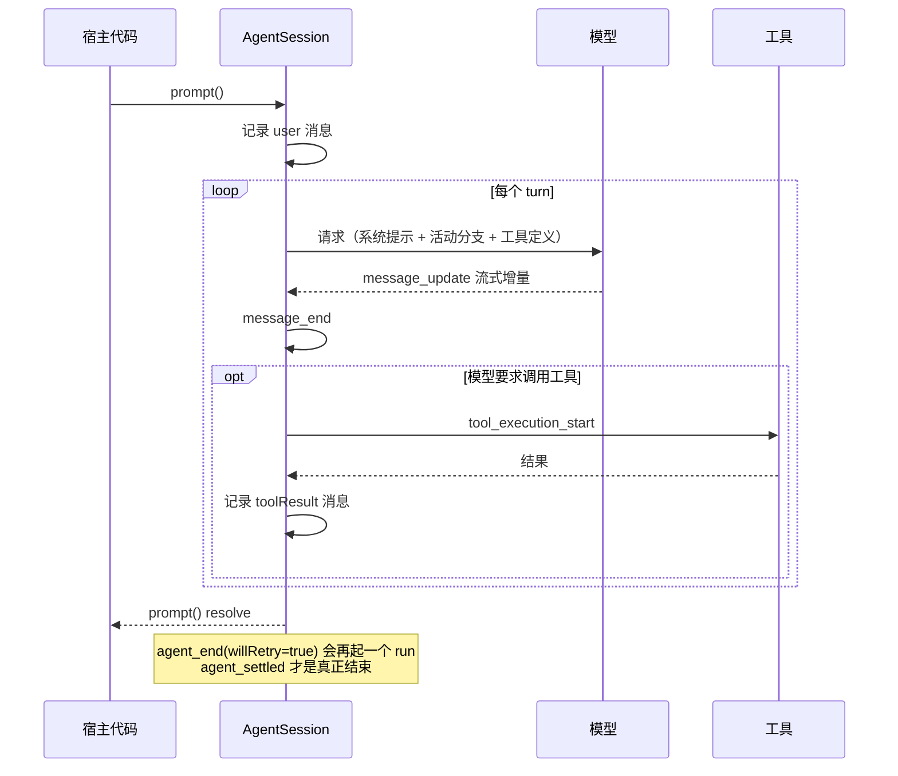

# 阶段 1：一次 prompt 的事件全流程

> 来源：`src/01-trace.ts` 的实测运行，SDK `@earendil-works/pi-coding-agent` 1.5.0。
> 原始数据：`traces/2026-11-24T07-48-31-554Z.jsonl`（77 个事件，142 KB）。
> 整理日期：2026-11-25

## 一、本次运行的真实时序

用真实时间戳画，每一行都能在 JSONL 里对上。

```
宿主
 │  await session.prompt("读一下 src/00-hello.ts …")
 ▼
╔════════════════════════ run #1 ════════════════════════╗
║                                                        ║
║ 0.00s  agent_start                                     ║
║ 0.00s  turn_start ── turn 1                            ║
║ 0.00s    │ message_start(system)      ← 记录           ║
║ 0.00s    │ message_start(user)        ← 记录           ║
║          │                                             ║
║          │ ◄──── 请求窗口 ────►                        ║
║          │      组装: 系统提示 + 活动分支 + 工具定义    ║
║ 3.83s    │ message_start(assistant)  ← 流开始了        ║
║ 3.8s     │ message_update ×N  (text_delta)             ║
║ 4.34s    │ message_end  stop=toolUse                   ║
║          │   ↳ 模型说：我要调 read                       ║
║ 4.34s    │ tool_execution_start(read)                   ║
║ 4.35s    │ tool_execution_end  (ok, 10ms)               ║
║ 4.35s    │ message_start(toolResult) ← 记录，不是发送    ║
║ 4.35s  turn_end                                        ║
║                                                        ║
║ 4.36s  turn_start ── turn 2                            ║
║ 14.5s    │ message_start(assistant)                     ║
║          │   ↳ 这次请求的上下文里才带上 toolResult       ║
║ 14.55s   │ message_end  stop=error "Request timed out." ║
║ 14.56s turn_end                                        ║
║ 14.56s agent_end  willRetry=true  ← 注意：不是终点       ║
╚════════════════════════════════════════════════════════╝
 │
 │  auto_retry_start（等 2s）
 ▼
╔════════════════════════ run #2 ════════════════════════╗
║ 16.57s agent_start          ← 新 run，不是续上旧的      ║
║ 16.57s turn_start ── turn 3                            ║
║ 20.5s    │ message_end  stop=stop                      ║
║ 20.5s  turn_end                                        ║
║ 20.52s agent_end  willRetry=false                      ║
║ 20.54s agent_settled        ← pi 保证不再自动动了       ║
╚════════════════════════════════════════════════════════╝
 │
 ▼
prompt() resolve，宿主继续
```

## 二、去掉时间戳后的通用循环

```
                    ┌──────────────────────────┐
                    │      session.prompt()     │
                    └────────────┬─────────────┘
                                 ▼
                           agent_start
                                 ▼
              ┌────────────► turn_start
              │                  ▼
              │        组装请求（系统提示 + 活动分支 + 工具）
              │                  ▼
              │      message_start(assistant)
              │                  ▼
              │      message_update × N（流式增量）
              │                  ▼
              │          message_end
              │                  ▼
              │           有 toolCall？
              │          ┌───────┴────────┐
              │        有│                │没有
              │          ▼                │
              │  tool_execution_start     │
              │          ▼                │
              │  tool_execution_end       │
              │          ▼                │
              │  记录 toolResult 消息      │
              │          ▼                │
              │       turn_end ◄──────────┘
              │          │
              └──────────┘（还有工具结果要喂回去 → 下一轮）
                         │（没有了）
                         ▼
                     agent_end
                         │
          ┌──────────────┴───────────────┐
   willRetry=true 或有排队消息        都没有
          │                              │
          ▼                              ▼
   auto_retry / 新 run            agent_settled
          │                              │
          └──────► agent_start           ▼
                                    真正空闲(idle)
```

## 三、两个最容易搞混的地方

### 1. 「记录」不等于「发送」

```
4.35s  message_start(toolResult) ──► 写进 transcript / JSONL
                                        （只是存起来）
4.36s  turn_start ──► 下一轮组装请求 ──► 这时才把 toolResult 放进上下文发给模型
```

工具一跑完并没有立刻发给模型，它是等下一个 turn 组装请求时才被带上。
日志里的 `role=toolResult` 事件，意思是“记下来了”，不是“送出去了”。

### 2. `agent_end` 不等于 `agent_settled`

```
run #1:  agent_end(willRetry=true) ──[5.7s, 中间重试了一次]──► agent_settled
run #2:  agent_end(willRetry=false) ──[2ms]──► agent_settled
```

- `agent_end`：一次低层 run 结束。**后面可能还有**自动重试、排队中的 steer / followUp 消息。
- `agent_settled`：pi 确定自己不会再自动往下跑了，也就是真正 idle。

所以“相隔多久”没有固定答案，取决于中间还有没有活要干。判断“真的结束了”看 `agent_settled`。

## 四、几个量出来的数字

这些不是猜的，是从那份 142 KB 的 JSONL 里算出来的：

| 指标 | 数值 | 说明 |
|---|---|---|
| 事件总数 | 77 | 一次“读文件 + 回答”的任务量 |
| `message_update` 条数 | 49 | 占事件数 64% |
| `message_update` 字节占比 | **50%** | 不是 90%（一开始估错了） |
| `text_delta` 的 delta 字符总和 | 143 | 真正的增量内容 |
| `partial` 快照里的文本总和 | 2077 | **14.5 倍重复** |
| 单条 `message_update` 大小 | 989 B → 2555 B | 随输出长度线性增长 |

结论：一条 N 字的回答会产生 **O(N²)** 的日志字节量，因为每条 delta 都带着“到目前为止的完整快照”。
工程含义：日志要么对 delta 采样，要么只保留 `message_end` 的最终形态。

## 五、Mermaid 版（Obsidian 可直接渲染）



## 六、四道题的精确答案

1. **turn 里的顺序**：`turn_start` → (system/user 记录) → 请求窗口 → `message_start(assistant)` → `message_update`×N → `message_end` → 有工具就执行并记录 `toolResult` → `turn_end`。
   `role=toolResult` 的 `message_start` 是**把工具结果写进消息历史和 JSONL**，不是发请求；发请求发生在下一个 turn。

2. **第 2 个 turn 失败后**：`message_end stop=error "Request timed out."` → `turn_end` → `agent_end(willRetry=true)` → `auto_retry_start`（等 2s）→ **新的 `agent_start`**（新的 run，turn 数继续累加）。重试是“再跑一个 run”，不是“接着上一个 run 继续”。

3. **`agent_end` vs `agent_settled`**：前者是一次 run 结束，后者是 pi 不会再自动继续。本次分别是 5.7s（跨重试）和 2ms（无后续工作）。

4. **`message_update` 为什么占一半体积**：每条都带完整 `partial` 快照，实际内容重复 14.5 倍，单条随输出增长，总量 O(N²)。

## 七、留给阶段 4 的线头

- 同一份 JSONL 里 `entry_appended` 记录的是会话树的**条目**，而 `message_start/end` 是**模型消息**。两者不是一一对应——阶段 4 讲分支和压缩时会用到这个区别。
- 现在每次运行都会在 `traces/` 和 `~/.pi/agent/sessions/--home-code-pi-study--/` 各留一份记录，前者是事件流，后者是会话树。对比着看最直观。
